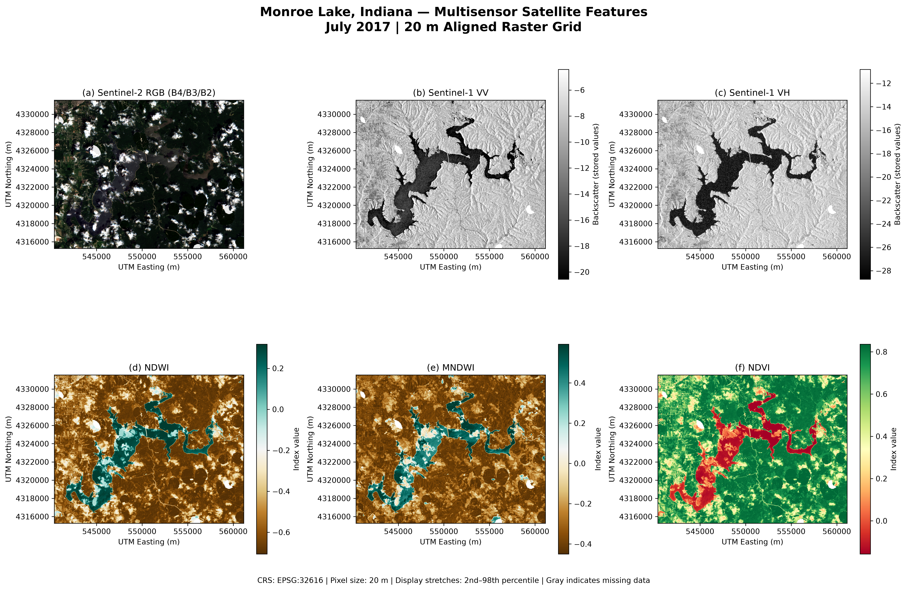
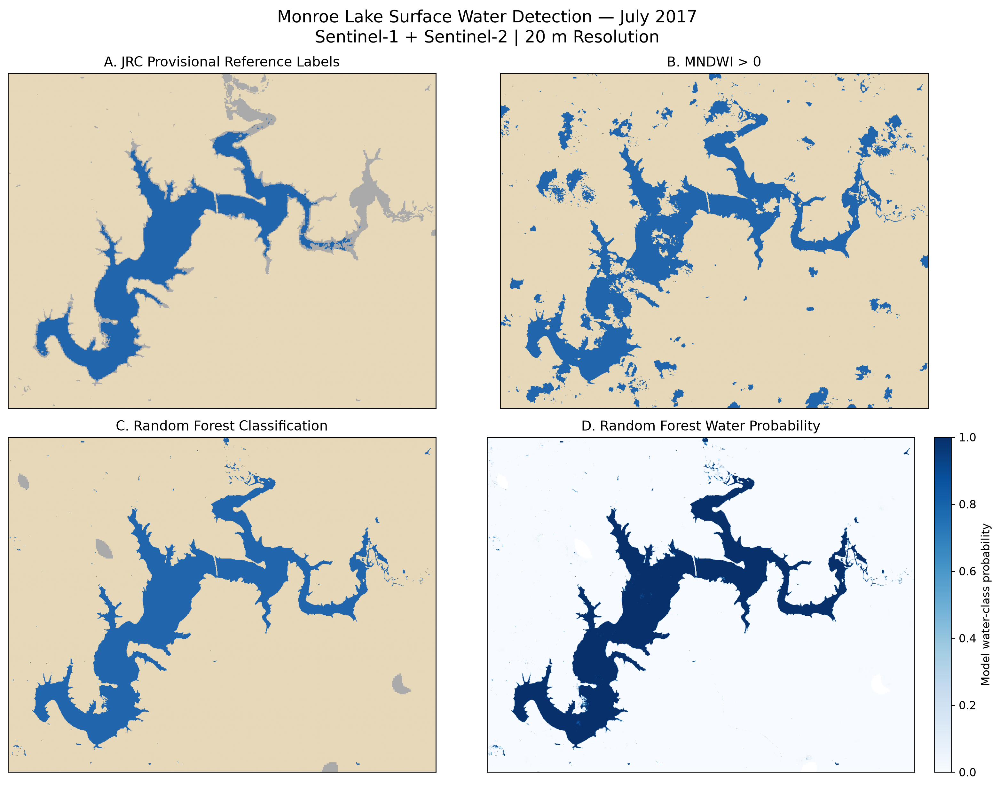
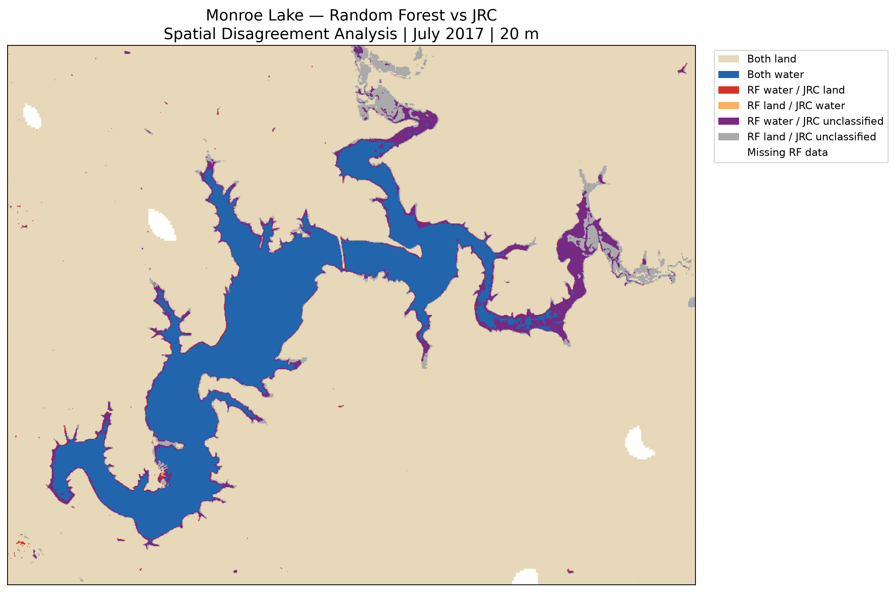

# Surface-Water Evaluation

**Multisensor Surface-Water Detection Using Sentinel-1, Sentinel-2, and Random Forest**

## Overview

This research project investigates surface-water classification using multisensor satellite imagery and machine learning.

The initial study focuses on Monroe Lake, Indiana, using July 2017 satellite observations. It evaluates a Random Forest classifier trained on combined Sentinel-1 radar, Sentinel-2 optical, and spectral-index features.

The project emphasizes reproducible geospatial processing, spatial evaluation, feature analysis, and comparisons with a conventional spectral-index baseline.

## Research Objectives

- Develop a reproducible multisensor surface-water classification workflow.
- Evaluate Random Forest agreement with JRC Global Surface Water reference labels.
- Compare Random Forest classification against an MNDWI threshold baseline.
- Investigate feature contributions, training sample size, and optical observation availability.
- Examine spatial disagreements and methodological limitations.

## Data Sources

| Dataset | Purpose |
|---|---|
| Sentinel-1 GRD | Radar backscatter (VV, VH) |
| Sentinel-2 Harmonized | Optical reflectance bands |
| JRC Global Surface Water | Historical reference labels |
| National Hydrography Dataset | Reference lake geometry |

**Study configuration:**
- Study period: July 2017
- Spatial resolution: 20 m
- Coordinate reference system: EPSG:32616
- Initial study area: Monroe Lake, Indiana

## Methodology

### 1. Satellite Data Preparation

Sentinel-1 VV/VH radar observations and Sentinel-2 optical imagery were processed and aligned to a common 20 m raster grid.

The Sentinel-2 composite uses selected July acquisitions and QA60-based cloud screening. The Sentinel-1 composite uses two July radar acquisitions from the same relative orbit.

### 2. Feature Engineering

The initial feature-stacking approach uses 10 predictors:

- Sentinel-1: VV, VH
- Sentinel-2: B2, B3, B4, B8, B11
- Spectral indices: NDWI, MNDWI, NDVI

### 3. Reference Labels

Historical JRC Global Surface Water data were used to construct provisional water and non-water reference labels.

These labels support model development and comparison but are not independent, date-specific ground truth for July 2017.

### 4. Random Forest Classification

The baseline classifier uses:

- 200 decision trees
- `max_features="sqrt"`
- `min_samples_leaf=2`
- `random_state=42`

Experiments include spatial cross-validation, feature ablation, training-size sensitivity, and observation-count analysis.

## Experimental Results

### Random Forest vs. MNDWI

The following results were reported for the spatial holdout experiment using 30 held-out blocks and 238,263 JRC-labeled evaluation pixels.

| Metric | Random Forest | MNDWI > 0 |
|---|---:|---:|
| Accuracy | 99.89% | 98.43% |
| Balanced accuracy | 99.94% | 95.73% |
| Water precision | 98.95% | 92.51% |
| Water recall | 100.00% | 92.31% |
| Water F1 | 99.47% | 92.41% |

**Interpretation:** Random Forest demonstrated higher agreement with the historical JRC reference labels than the fixed MNDWI threshold in this experiment.

These results must not be interpreted as independently verified classification accuracy or proof that multisensor fusion outperforms individual sensors.

## Research Visualizations

### Satellite Features



### Classification Comparison



### Spatial Disagreement Analysis



### Additional Experiments

- [Spatial cross-validation](results/visualizations/02_baseline_fold_performance.png)
- [Feature-group ablation](results/visualizations/03_feature_group_ablation.png)
- [Individual-feature ablation](results/visualizations/04_individual_feature_ablation.png)
- [Training-size sensitivity](results/visualizations/05_training_size_sensitivity.png)
- [Spatial fold visualization](results/visualizations/06_spatial_cross_validation_folds.png)

## Computing Environment

Experiments were developed and executed using university high-performance computing infrastructure.

Technologies include:

Python, Rasterio, NumPy, pandas, scikit-learn, GDAL, Google Earth Engine, QGIS, Linux, and SLURM.

The repository includes Python scripts, SLURM job scripts, experimental metrics, visualizations, and research documentation.

## Repository Structure

```text
surface-water-evaluation/
├── scripts/
├── documentation/
│   └── research_log.md
├── results/
│   ├── evaluation/
│   ├── monthly_jrc_rf_cv/
│   ├── monthly_jrc_rf_ablation/
│   ├── monthly_jrc_rf_individual_ablation/
│   ├── monthly_jrc_rf_sample_sizes/
│   ├── experiment5_observation_count/
│   ├── figures/
│   └── visualizations/
├── .gitignore
└── README.md
```

## Scientific Limitations

- JRC-derived labels are historical weak supervision rather than independent July 2017 observations.
- The initial experiments focus on one study area and one period.
- Adjacent spatial blocks may retain spatial dependence.
- Cloud-shadow contamination may remain in Sentinel-2 imagery.
- Sentinel-1 and Sentinel-2 acquisition dates differ.
- Uncertain JRC pixels are excluded from certain evaluation metrics.
- Independent validation is necessary before drawing broader accuracy or generalization conclusions.

## Future Research

The next research direction will investigate a separate-model approach:

1. Train a Sentinel-2 Random Forest as the primary surface-water classifier.
2. Train a Sentinel-1 Random Forest independently.
3. Identify pixels without valid Sentinel-2 observations.
4. Use Sentinel-1 predictions to fill eligible optical-data gaps.
5. Evaluate classification agreement, gap-filling performance, and spatial coverage.

This planned approach will be compared with the existing feature-stacking baseline.

## Research Documentation

Detailed experiment notes are available in [research_log.md](documentation/research_log.md).

## Project Status

**Ongoing independent-study research.** Baseline experiments are documented; further validation and model comparisons are planned.
